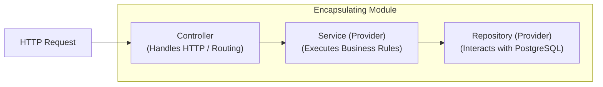
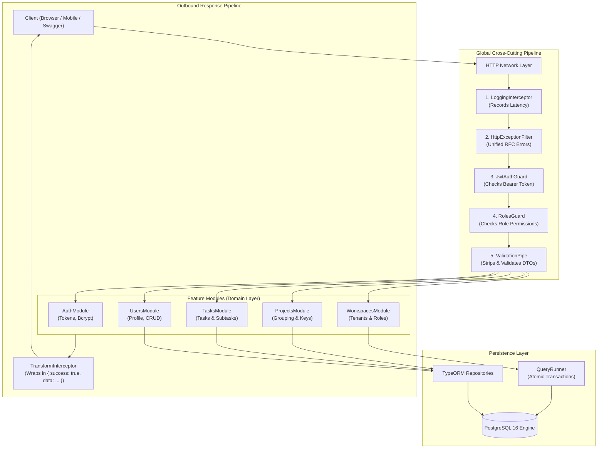
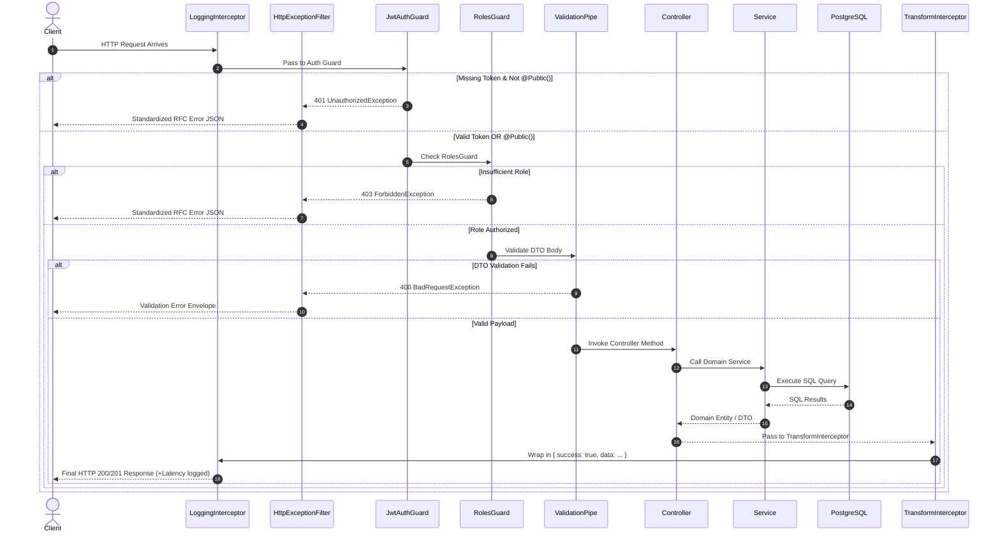
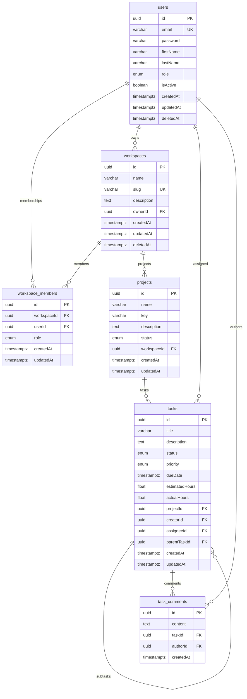
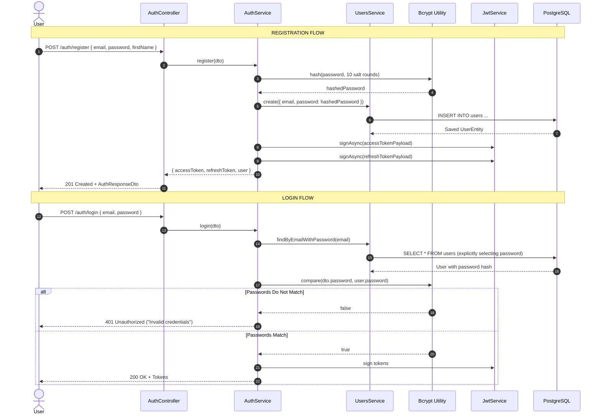
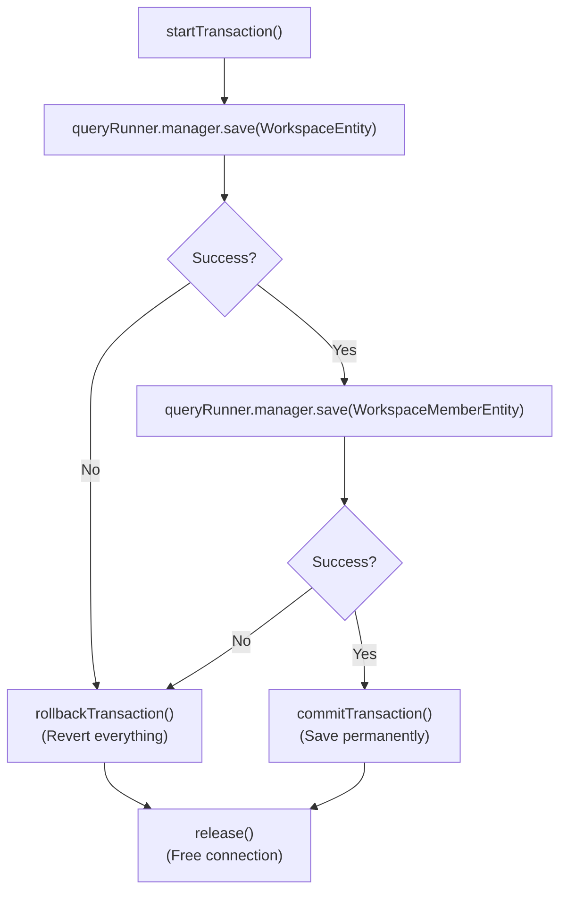
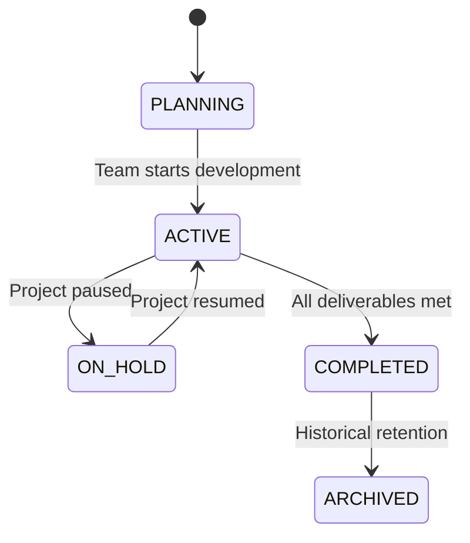
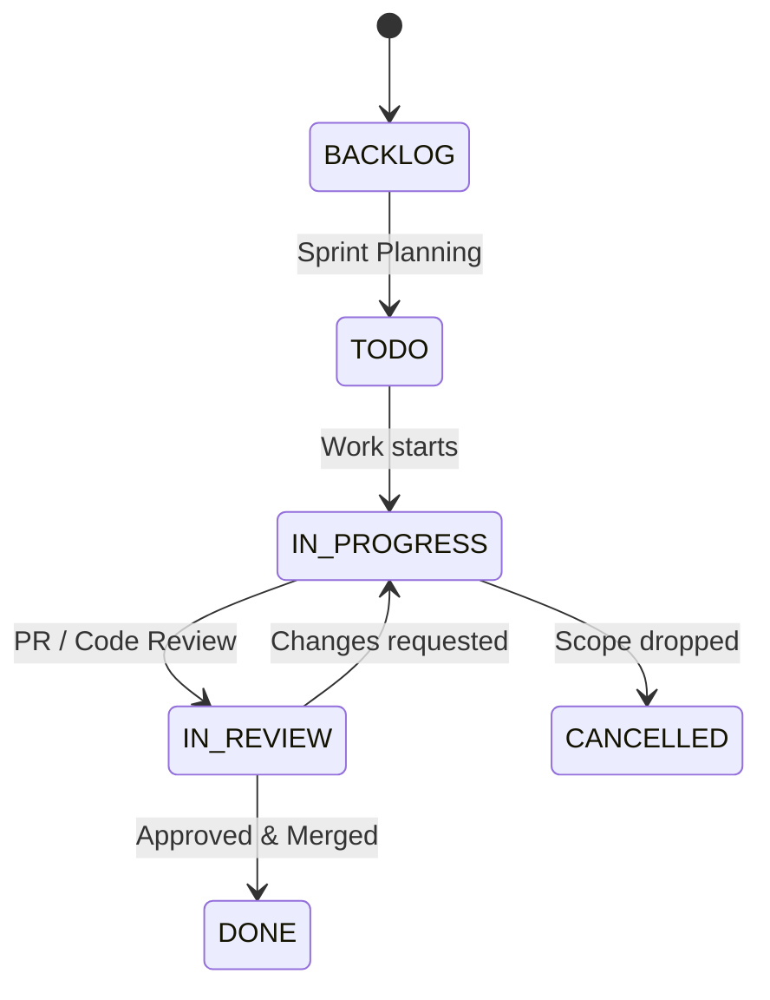

# 📚 The Complete NestJS & PostgreSQL Architecture E-Book
## A Comprehensive Line-by-Line & Function-by-Function Engineering Guide for TaskFlow Core

---

## 📖 Welcome & How to Read This Book

This e-book is designed as an exhaustive, self-contained reference manual for **TaskFlow Core**. Every file, decorator, entity, DTO, guard, interceptor, and function in this project is unpacked line-by-line with architectural diagrams, comparison tables, and execution traces.

Whether you are learning NestJS from scratch or studying how to design resilient SaaS backends in TypeScript and PostgreSQL, this guide will walk you through the codebase from the initial bootstrap to unit testing and transaction management.

---

# 📑 Master Table of Contents

1. [Chapter 1: The Architectural Blueprint & Mental Model](#chapter-1-the-architectural-blueprint--mental-model)
   - 1.1 From Express to NestJS: The Paradigm Shift
   - 1.2 The Three Pillars: Modules, Providers, and Controllers
   - 1.3 High-Level System Architecture Diagram
2. [Chapter 2: Application Bootstrapping & Configuration](#chapter-2-application-bootstrapping--configuration)
   - 2.1 The Entry Point: Line-by-Line Breakdown of `main.ts`
   - 2.2 The Root Orchestrator: `app.module.ts`
   - 2.3 The Configuration System (`src/config/`)
3. [Chapter 3: The Cross-Cutting Request Pipeline (`src/common/`)](#chapter-3-the-cross-cutting-request-pipeline-srccommon)
   - 3.1 The Request-Response Lifecycle Sequence
   - 3.2 Interceptors: `LoggingInterceptor` & `TransformInterceptor`
   - 3.3 Exception Filtering: `HttpExceptionFilter`
   - 3.4 Guards & Authorization: `JwtAuthGuard` & `RolesGuard`
   - 3.5 Custom Decorators: `@Public()`, `@Roles()`, and `@CurrentUser()`
   - 3.6 Generic Pagination System & Mathematical Formulas
4. [Chapter 4: Database Design & PostgreSQL Entity Modeling](#chapter-4-database-design--postgresql-entity-modeling)
   - 4.1 Relational Entity-Relationship Diagram (ERD)
   - 4.2 The Foundation: `BaseEntity` (UUIDs & Soft Deletes)
   - 4.3 `UserEntity`: Concealed Credentials & System Roles
   - 4.4 `WorkspaceEntity` & `WorkspaceMemberEntity`: Multi-Tenancy Junction
   - 4.5 `ProjectEntity`: Composite Uniqueness
   - 4.6 `TaskEntity`: Self-Referential Subtasks & Estimates
   - 4.7 `CommentEntity`: Discussion Threads
5. [Chapter 5: Identity & Authentication Module (`AuthModule` & `UsersModule`)](#chapter-5-identity--authentication-module)
   - 5.1 Authentication Flow Sequence Diagram
   - 5.2 Password Security & Token Rotation
   - 5.3 Function-by-Function Walkthrough: `AuthService`
   - 5.4 Function-by-Function Walkthrough: `UsersService`
   - 5.5 Controllers & DTOs
6. [Chapter 6: Multi-Tenant Workspaces & Atomic Transactions (`WorkspacesModule`)](#chapter-6-multi-tenant-workspaces--atomic-transactions)
   - 6.1 Multi-Tenancy Concept in SaaS
   - 6.2 The Anatomy of a Database Transaction (`QueryRunner`)
   - 6.3 Function-by-Function Walkthrough: `WorkspacesService`
   - 6.4 Workspace Role Verification Mechanism
7. [Chapter 7: Project & Task Management Workflows (`ProjectsModule` & `TasksModule`)](#chapter-7-project--task-management-workflows)
   - 7.1 Lifecycle State Machines: Project & Task Statuses
   - 7.2 Function-by-Function Walkthrough: `ProjectsService`
   - 7.3 Function-by-Function Walkthrough: `TasksService` & Subtasks
   - 7.4 Safe Dynamic SQL with `QueryBuilder`
8. [Chapter 8: Automated Database Initialization & Seeding](#chapter-8-automated-database-initialization--seeding)
   - 8.1 PostgreSQL System Catalogs (`pg_database`)
   - 8.2 Line-by-Line Breakdown of `initial-seed.ts`
9. [Chapter 9: Testing Strategy: Unit Testing & Mocks](#chapter-9-testing-strategy-unit-testing--mocks)
   - 9.1 Unit Testing with Mocks (`auth.service.spec.ts`)
   - 9.2 End-to-End Testing (`test/app.e2e-spec.ts`)
10. [Chapter 10: Complete API Reference & Status Code Dictionary](#chapter-10-complete-api-reference--status-code-dictionary)

---

# Chapter 1: The Architectural Blueprint & Mental Model

## 1.1 From Express to NestJS: The Paradigm Shift

In traditional Express or Node.js applications, project organization is completely unopinionated. Developers often write spaghetti code where routing, SQL queries, authentication, and validation are mixed together in callback functions:

```js
// ❌ Traditional Express: Unstructured & Fragile
app.post('/tasks', async (req, res) => {
  if (!req.headers.authorization) return res.status(401).send('Unauthorized');
  const user = verifyToken(req.headers.authorization);
  if (!req.body.title) return res.status(400).send('Title required');
  const task = await db.query('INSERT INTO tasks ...', [req.body.title]);
  res.json(task);
});
```

NestJS fundamentally changes this by enforcing **Clean Architecture** and **Domain-Driven Design (DDD)**:

| Architectural Concern | Express Approach | NestJS Approach |
| :--- | :--- | :--- |
| **Dependency Management** | Manual `require()` / `new Class()` | **Inversion of Control (IoC) Container** with Constructor Injection |
| **Input Validation** | Manual `if/else` checks | **Declarative DTOs** with `class-validator` |
| **Authentication & Auth** | Ad-hoc middleware chains | **Guards** with reflection metadata (`@Public()`, `@Roles()`) |
| **Response Standardization**| Inconsistent `res.send()` | **Global Interceptors** wrapping all outputs automatically |
| **Error Handling** | Scattered `try/catch` blocks | **Global Exception Filters** catching all exceptions |
| **Database Access** | Raw SQL strings | **TypeORM Entities** & Repository Pattern |

---

## 1.2 The Three Pillars: Modules, Providers, and Controllers

NestJS builds everything using three primary structural primitives:



1. **Controllers (`@Controller`)**: Their only job is to handle incoming HTTP requests (GET, POST, PATCH, DELETE), extract path parameters or request bodies, and delegate the work to services. Controllers do **not** write to databases or calculate business rules.
2. **Providers / Services (`@Injectable`)**: Plain TypeScript classes containing business logic. They can be injected into controllers or other services.
3. **Modules (`@Module`)**: The organizing containers that package related controllers, providers, and database entities together, declaring what they import and export.

---

## 1.3 High-Level System Architecture Diagram



---

# Chapter 2: Application Bootstrapping & Configuration

## 2.1 The Entry Point: Line-by-Line Breakdown of `main.ts`

Open [`src/main.ts`](file:///c:/Projects/Self/Learning/nest-projects/taskflow-api/src/main.ts). This file is executed when Node.js boots.

```typescript
import { NestFactory } from '@nestjs/core';
import { Logger, ValidationPipe } from '@nestjs/common';
import { ConfigService } from '@nestjs/config';
import { DocumentBuilder, SwaggerModule } from '@nestjs/swagger';
import { AppModule } from './app.module';

async function bootstrap() {
```

### Lines 7–9: Instantiating the Engine
```typescript
  const logger = new Logger('Bootstrap');
  const app = await NestFactory.create(AppModule);
```
- **`new Logger('Bootstrap')`**: Creates a namespaced terminal logger instance. Messages logged through this will appear with `[Bootstrap]` prefixed in yellow.
- **`NestFactory.create(AppModule)`**: Instructs NestJS to initialize the dependency injection tree rooted at `AppModule`. It boots Express under the hood, binds routes, and prepares database connection pools.

### Lines 11–14: Type-Safe Configuration Resolution
```typescript
  const configService = app.get(ConfigService);
  const port = configService.get<number>('app.port', 3000);
  const apiPrefix = configService.get<string>('app.apiPrefix', 'api/v1');
  const appName = configService.get<string>('app.appName', 'TaskFlow Core API');
```
- **`app.get(ConfigService)`**: Pulls the registered `ConfigService` singleton from the IoC container.
- **`configService.get<number>('app.port', 3000)`**: Reads the loaded application port. If `.env` omits it, it falls back to `3000`.

### Lines 16–21: CORS Configuration
```typescript
  app.enableCors({
    origin: true,
    credentials: true,
    methods: ['GET', 'POST', 'PUT', 'PATCH', 'DELETE', 'OPTIONS'],
  });
```
- **`origin: true`**: Dynamically reflects the request origin, allowing authorized frontends on any host/port to communicate with the API.
- **`credentials: true`**: Permits clients to send cookies and authorization headers across origins.

### Line 24: Graceful Shutdown Hooks
```typescript
  app.enableShutdownHooks();
```
- Listens for OS process signals (`SIGTERM`, `SIGINT`). When Kubernetes, Docker, or a developer terminates the process, NestJS calls `onModuleDestroy()` and `beforeApplicationShutdown()` on all services, ensuring database connection pools are closed gracefully without terminating in-flight queries.

### Line 27: Global API Prefix
```typescript
  app.setGlobalPrefix(apiPrefix);
```
- Prefixes every route in the application with `api/v1`. 

### Lines 30–39: Strict Validation Pipe
```typescript
  app.useGlobalPipes(
    new ValidationPipe({
      whitelist: true,
      forbidNonWhitelisted: true,
      transform: true,
      transformOptions: {
        enableImplicitConversion: true,
      },
    }),
  );
```

| Setting | Purpose | What Happens If Violated? |
| :--- | :--- | :--- |
| `whitelist: true` | Strips properties that have no decorator in the corresponding DTO. | Prevents mass-assignment vulnerabilities. |
| `forbidNonWhitelisted: true` | Rejects any request that contains unwhitelisted properties. | Throws a `400 Bad Request` with message: `"property foo should not exist"`. |
| `transform: true` | Converts incoming plain JSON objects into actual TypeScript class instances. | Ensures `instanceof` and DTO helper methods work properly. |
| `enableImplicitConversion: true` | Automatically coerces primitive types in query params and path params. | `?page=2` becomes number `2`, not string `"2"`. |

### Lines 42–76: Interactive Swagger OpenAPI 3.0 Documentation
```typescript
  const swaggerConfig = new DocumentBuilder()
    .setTitle(appName)
    .setDescription(...)
    .setVersion('1.0.0')
    .addBearerAuth(
      {
        type: 'http',
        scheme: 'bearer',
        bearerFormat: 'JWT',
        name: 'JWT',
        description: 'Enter your JWT access token below',
        in: 'header',
      },
      'JWT-auth',
    )
    .build();

  const document = SwaggerModule.createDocument(app, swaggerConfig);
  SwaggerModule.setup('api/docs', app, document, {
    swaggerOptions: {
      persistAuthorization: true,
      tagsSorter: 'alpha',
      operationsSorter: 'alpha',
    },
  });
```
- **`addBearerAuth`**: Registers the `JWT-auth` security scheme in Swagger. This gives developers the interactive **"Authorize"** button in the Swagger UI.
- **`persistAuthorization: true`**: Keeps your JWT token saved in browser local storage so refreshing the Swagger page doesn't log you out!
- **`SwaggerModule.setup('api/docs', ...)`**: Mounts the Swagger dashboard at `http://localhost:3000/api/docs`.

---

## 2.2 The Root Orchestrator: `app.module.ts`

Open [`src/app.module.ts`](file:///c:/Projects/Self/Learning/nest-projects/taskflow-api/src/app.module.ts).

```typescript
@Module({
  imports: [
    ConfigModule.forRoot({
      isGlobal: true,
      load: [appConfig, databaseConfig, jwtConfig],
      envFilePath: ['.env'],
    }),
    DatabaseModule,
    AuthModule,
    UsersModule,
    WorkspacesModule,
    ProjectsModule,
    TasksModule,
  ],
  providers: [
    { provide: APP_GUARD, useClass: JwtAuthGuard },
    { provide: APP_GUARD, useClass: RolesGuard },
    { provide: APP_INTERCEPTOR, useClass: TransformInterceptor },
    { provide: APP_INTERCEPTOR, useClass: LoggingInterceptor },
    { provide: APP_FILTER, useClass: HttpExceptionFilter },
  ],
})
export class AppModule {}
```

### The System Tokens (`APP_GUARD`, `APP_INTERCEPTOR`, `APP_FILTER`)
In NestJS, if you want a Guard, Interceptor, or Filter to apply across the entire application, you could bind it in `main.ts` via `app.useGlobalGuards(new JwtAuthGuard())`. **However, doing that prevents dependency injection** because `new` bypasses Nest's IoC container!

By binding them in `app.module.ts` providers using Nest's built-in tokens:
- `JwtAuthGuard` can inject `Reflector`.
- `LoggingInterceptor` can inject services or loggers.
- NestJS instantiates them inside the IoC container automatically.

---

## 2.3 The Configuration System (`src/config/`)

Instead of accessing `process.env` directly in services (which is prone to typos and missing variables), we use modular namespace loaders:

- [`src/config/app.config.ts`](file:///c:/Projects/Self/Learning/nest-projects/taskflow-api/src/config/app.config.ts): Loads port, environment (`development`/`production`), and API prefix under the `'app'` namespace.
- [`src/config/database.config.ts`](file:///c:/Projects/Self/Learning/nest-projects/taskflow-api/src/config/database.config.ts): Loads database host, port, credentials, and TypeORM synchronize flags under the `'database'` namespace.
- [`src/config/jwt.config.ts`](file:///c:/Projects/Self/Learning/nest-projects/taskflow-api/src/config/jwt.config.ts): Loads token secrets and expirations under the `'jwt'` namespace.
- [`src/config/typeorm.config.ts`](file:///c:/Projects/Self/Learning/nest-projects/taskflow-api/src/config/typeorm.config.ts): Exports a standalone `DataSource` instance used by the TypeORM CLI for generating and running database migrations.

---

# Chapter 3: The Cross-Cutting Request Pipeline (`src/common/`)

## 3.1 The Request-Response Lifecycle Sequence

Here is the exact millisecond-by-millisecond path of every HTTP request entering TaskFlow Core:



---

## 3.2 Interceptors

Interceptors are powered by **RxJS (Reactive Extensions for JavaScript)**. They wrap the execution of route handlers, allowing you to run code both **before** the method executes and **after** it finishes.

### 1. `LoggingInterceptor`
Open [`src/common/interceptors/logging.interceptor.ts`](file:///c:/Projects/Self/Learning/nest-projects/taskflow-api/src/common/interceptors/logging.interceptor.ts):

```typescript
@Injectable()
export class LoggingInterceptor implements NestInterceptor {
  private readonly logger = new Logger('HTTP');

  intercept(context: ExecutionContext, next: CallHandler): Observable<any> {
    const request = context.switchToHttp().getRequest<Request>();
    const { method, originalUrl } = request;
    const now = Date.now();

    return next.handle().pipe(
      tap({
        next: () => {
          const response = context.switchToHttp().getResponse();
          const statusCode = response.statusCode;
          const delay = Date.now() - now;
          this.logger.log(`[${method}] ${originalUrl} ${statusCode} +${delay}ms`);
        },
        error: (err) => {
          const delay = Date.now() - now;
          this.logger.error(`[${method}] ${originalUrl} FAILED +${delay}ms - ${err.message}`);
        },
      }),
    );
  }
}
```
- **`context.switchToHttp().getRequest()`**: Extracts the underlying Express request object regardless of transport protocol.
- **`next.handle()`**: Hands execution off to the route handler.
- **`tap(...)`**: An RxJS operator that triggers side-effects (logging) without mutating the returned data. If the handler succeeds, it calculates `Date.now() - now` and prints `[GET] /api/v1/projects 200 +8ms`.

---

### 2. `TransformInterceptor`
Open [`src/common/interceptors/transform.interceptor.ts`](file:///c:/Projects/Self/Learning/nest-projects/taskflow-api/src/common/interceptors/transform.interceptor.ts):

```typescript
@Injectable()
export class TransformInterceptor<T> implements NestInterceptor<T, ResponseEnvelope<T>> {
  intercept(context: ExecutionContext, next: CallHandler): Observable<ResponseEnvelope<T>> {
    const response = context.switchToHttp().getResponse();
    const statusCode = response.statusCode;

    return next.handle().pipe(
      map((data) => ({
        success: true,
        statusCode,
        data,
        timestamp: new Date().toISOString(),
      })),
    );
  }
}
```
- **`map(...)`**: An RxJS operator that transforms the stream. Whatever value your service returns (`return project;`) is automatically wrapped into `{ success: true, statusCode: 200, data: project, timestamp: ... }`.

---

## 3.3 Exception Filtering: `HttpExceptionFilter`

Open [`src/common/filters/http-exception.filter.ts`](file:///c:/Projects/Self/Learning/nest-projects/taskflow-api/src/common/filters/http-exception.filter.ts).

### Why do we need an Exception Filter?
Without a global filter, unhandled errors crash the process or return generic HTML pages. `HttpExceptionFilter` intercepts **any** exception thrown anywhere in the application:

```typescript
@Catch()
export class HttpExceptionFilter implements ExceptionFilter {
  catch(exception: unknown, host: ArgumentsHost) {
    const ctx = host.switchToHttp();
    const response = ctx.getResponse<Response>();
    const request = ctx.getRequest<Request>();

    let status = HttpStatus.INTERNAL_SERVER_ERROR;
    let message: string | object = 'Internal server error occurred';
    let errors: any = null;

    if (exception instanceof HttpException) {
      status = exception.getStatus();
      const res = exception.getResponse();
      ...
    }
```
- **`@Catch()` (with empty parentheses)**: Catch-all filter. It catches both known `HttpException` (e.g. `NotFoundException`, `ConflictException`) and raw unexpected JavaScript runtime bugs (`TypeError`, `DatabaseConnectionError`).
- It parses validation arrays generated by `ValidationPipe` and structures them into a clean array:
  ```json
  {
    "success": false,
    "statusCode": 400,
    "message": "Validation failed",
    "errors": [
      "email must be a valid email address",
      "password must be at least 8 characters long"
    ],
    "path": "/api/v1/auth/register",
    "method": "POST",
    "timestamp": "2026-10-31T20:00:00.000Z"
  }
  ```

---

## 3.4 Guards & Authorization

Guards determine whether a given request should be allowed to reach the route handler or not.

### 1. `JwtAuthGuard` (Default-Deny Pattern)
Open [`src/common/guards/jwt-auth.guard.ts`](file:///c:/Projects/Self/Learning/nest-projects/taskflow-api/src/common/guards/jwt-auth.guard.ts):

```typescript
@Injectable()
export class JwtAuthGuard extends AuthGuard('jwt') {
  constructor(private reflector: Reflector) {
    super();
  }

  canActivate(context: ExecutionContext) {
    const isPublic = this.reflector.getAllAndOverride<boolean>(IS_PUBLIC_KEY, [
      context.getHandler(),
      context.getClass(),
    ]);

    if (isPublic) {
      return true;
    }

    return super.canActivate(context);
  }
}
```
- Extends Nest's built-in `AuthGuard('jwt')` from `@nestjs/passport`.
- **`this.reflector.getAllAndOverride<boolean>(IS_PUBLIC_KEY, ...)`**: Inspects if the endpoint has `@Public()` on either the method or the controller class.
- If `@Public()` is present, it returns `true` immediately, letting the request proceed without a token.
- If `@Public()` is NOT present, it executes `super.canActivate(context)`, requiring a valid JWT token.

---

### 2. `RolesGuard` (Role-Based Access Control)
Open [`src/common/guards/roles.guard.ts`](file:///c:/Projects/Self/Learning/nest-projects/taskflow-api/src/common/guards/roles.guard.ts):

```typescript
@Injectable()
export class RolesGuard implements CanActivate {
  constructor(private reflector: Reflector) {}

  canActivate(context: ExecutionContext): boolean {
    const requiredRoles = this.reflector.getAllAndOverride<Role[]>(ROLES_KEY, [
      context.getHandler(),
      context.getClass(),
    ]);

    if (!requiredRoles || requiredRoles.length === 0) {
      return true;
    }

    const request = context.switchToHttp().getRequest();
    const user: AuthenticatedUser = request.user;

    if (!user || !user.role || !requiredRoles.includes(user.role)) {
      throw new ForbiddenException(ERROR_MESSAGES.INSUFFICIENT_PERMISSIONS);
    }

    return true;
  }
}
```
- Reads the required roles specified by `@Roles(...)`.
- Compares `requiredRoles` against `request.user.role`. If the user does not match, it throws a `403 ForbiddenException`.

---

## 3.5 Custom Parameter Decorators

### `@CurrentUser()`
Open [`src/common/decorators/current-user.decorator.ts`](file:///c:/Projects/Self/Learning/nest-projects/taskflow-api/src/common/decorators/current-user.decorator.ts):

```typescript
export const CurrentUser = createParamDecorator(
  (data: keyof AuthenticatedUser | undefined, ctx: ExecutionContext) => {
    const request = ctx.switchToHttp().getRequest();
    const user = request.user as AuthenticatedUser;

    if (!user) return null;
    return data ? user[data] : user;
  },
);
```

How it is used in controllers:
```typescript
// 1. Injects entire user object
@Get('me')
getProfile(@CurrentUser() user: AuthenticatedUser) { ... }

// 2. Injects just the string ID
@Post('workspaces')
createWorkspace(@CurrentUser('id') userId: string) { ... }
```

---

## 3.6 Generic Pagination System & Mathematical Formulas

Open [`src/common/dto/pagination.dto.ts`](file:///c:/Projects/Self/Learning/nest-projects/taskflow-api/src/common/dto/pagination.dto.ts).

### Pagination Calculations
To paginate SQL records, we need two values:
1. **`limit`**: How many items to fetch.
2. **`skip` (offset)**: How many items to skip past.

The mathematical formula implemented in `PaginationDto`:
$$\text{skip} = (\text{page} - 1) \times \text{limit}$$

Example: If `page = 3` and `limit = 10`:
$$\text{skip} = (3 - 1) \times 10 = 20$$
*(The database skips the first 20 records and returns records 21 to 30).*

### Total Pages Formula
The total number of pages is calculated as:
$$\text{totalPages} = \left\lceil \frac{\text{totalItems}}{\text{limit}} \right\rceil$$

---

# Chapter 4: Database Design & PostgreSQL Entity Modeling

## 4.1 Relational Entity-Relationship Diagram (ERD)



---

## 4.2 The Foundation: `BaseEntity` (UUIDs & Soft Deletes)

Open [`src/database/base.entity.ts`](file:///c:/Projects/Self/Learning/nest-projects/taskflow-api/src/database/base.entity.ts):

```typescript
export abstract class BaseEntity {
  @PrimaryGeneratedColumn('uuid')
  id: string;

  @CreateDateColumn({ type: 'timestamptz', default: () => 'CURRENT_TIMESTAMP' })
  createdAt: Date;

  @UpdateDateColumn({ type: 'timestamptz', default: () => 'CURRENT_TIMESTAMP' })
  updatedAt: Date;

  @DeleteDateColumn({ type: 'timestamptz', nullable: true })
  deletedAt?: Date;
}
```

- **`@PrimaryGeneratedColumn('uuid')`**: Generates a 128-bit UUID v4 (e.g., `a0eebc99-9c0b-4ef8-bb6d-6bb9bd380a11`). Prevents database key scraping.
- **`@CreateDateColumn` & `@UpdateDateColumn`**: Automatically populated by TypeORM when records are inserted or updated.
- **`@DeleteDateColumn` (Soft Deletes)**: Instead of executing SQL `DELETE FROM table WHERE id = ...`, calling `repository.softRemove(entity)` sets `deletedAt = NOW()`. Any standard query (`repository.find()`) automatically appends `WHERE deletedAt IS NULL`, preserving audit trails.

---

## 4.3 `UserEntity`: Concealed Credentials & System Roles

Open [`src/modules/users/entities/user.entity.ts`](file:///c:/Projects/Self/Learning/nest-projects/taskflow-api/src/modules/users/entities/user.entity.ts):

```typescript
@Entity('users')
export class UserEntity extends BaseEntity {
  @Column({ unique: true, length: 150 })
  email: string;

  @Column({ select: false })
  password: string;

  @Column({ length: 100, nullable: true })
  firstName: string;

  @Column({ length: 100, nullable: true })
  lastName: string;

  @Column({ type: 'enum', enum: Role, default: Role.USER })
  role: Role;

  @Column({ default: true })
  isActive: boolean;
```
- **`@Column({ select: false })`**: Critical security pattern. In TypeORM, setting `select: false` means that `userRepository.find()` or joins will **never** include the password column in the SQL query, preventing accidental leaks to API responses.

---

## 4.4 `WorkspaceEntity` & `WorkspaceMemberEntity`: Multi-Tenancy Junction

### Unique Composite Keys
In [`src/modules/workspaces/entities/workspace-member.entity.ts`](file:///c:/Projects/Self/Learning/nest-projects/taskflow-api/src/modules/workspaces/entities/workspace-member.entity.ts):

```typescript
@Entity('workspace_members')
@Unique(['workspaceId', 'userId'])
export class WorkspaceMemberEntity extends BaseEntity { ... }
```
- **`@Unique(['workspaceId', 'userId'])`**: Creates a composite unique index in PostgreSQL. A user can belong to 50 workspaces, but they can **never** be added twice to the *same* workspace.

---

## 4.5 `ProjectEntity`: Composite Uniqueness

In [`src/modules/projects/entities/project.entity.ts`](file:///c:/Projects/Self/Learning/nest-projects/taskflow-api/src/modules/projects/entities/project.entity.ts):

```typescript
@Entity('projects')
@Unique(['workspaceId', 'key'])
export class ProjectEntity extends BaseEntity {
  @Column({ length: 10 })
  key: string;
```
- Project keys are short acronyms (e.g., `CORE`, `AUTH`, `MOBILE`).
- `@Unique(['workspaceId', 'key'])` allows Workspace 1 to have a project with key `CORE`, and Workspace 2 to *also* have a project with key `CORE`, but forbids duplicate keys within the same workspace!

---

## 4.6 `TaskEntity`: Self-Referential Subtasks & Estimates

Open [`src/modules/tasks/entities/task.entity.ts`](file:///c:/Projects/Self/Learning/nest-projects/taskflow-api/src/modules/tasks/entities/task.entity.ts):

```typescript
  @ManyToOne(() => TaskEntity, (task) => task.subtasks, {
    onDelete: 'CASCADE',
    nullable: true,
  })
  parentTask: TaskEntity;

  @Column({ nullable: true })
  parentTaskId: string;

  @OneToMany(() => TaskEntity, (task) => task.parentTask)
  subtasks: TaskEntity[];
```
- **Self-Referential Association**: A `TaskEntity` has a foreign key `parentTaskId` pointing to another record in the **exact same** `tasks` table. This allows nested trees of subtasks of arbitrary depth.
- **`onDelete: 'CASCADE'`**: If a parent task is deleted, PostgreSQL cascades and automatically deletes all of its subtasks.

---

# Chapter 5: Identity & Authentication Module (`AuthModule` & `UsersModule`)

## 5.1 Authentication Flow Sequence Diagram



---

## 5.2 Password Security & Token Rotation

### Why Bcrypt with 10 Salt Rounds?
Bcrypt is a slow hashing algorithm with built-in salting. The 10 salt rounds create $2^{10} = 1,024$ hashing iterations, making brute-force dictionary attacks practically impossible.

### Token Expiration Strategy:
- **`accessToken`**: Short-lived (1 day). Contains user ID and global role.
- **`refreshToken`**: Long-lived (7 days). Signed with a separate secret key (`JWT_REFRESH_SECRET`).

---

## 5.3 Function-by-Function Walkthrough: `AuthService`

Open [`src/modules/auth/auth.service.ts`](file:///c:/Projects/Self/Learning/nest-projects/taskflow-api/src/modules/auth/auth.service.ts):

### `register(registerDto: RegisterDto): Promise<AuthResponseDto>`
- **Input**: User email, password, and optional names.
- **Process**:
  1. Hashes password using `bcrypt.hash(password, 10)`.
  2. Calls `usersService.create(...)`.
  3. Generates token pair.
- **Output**: Returns tokens and sanitized `UserResponseDto`.

### `login(loginDto: LoginDto): Promise<AuthResponseDto>`
- **Input**: Email and password.
- **Process**:
  1. Calls `usersService.findByEmailWithPassword(email)`.
  2. If user is null, throws `UnauthorizedException` (generic error to prevent account enumeration).
  3. Validates password via `bcrypt.compare`.
  4. Checks if `user.isActive === true`.
  5. Generates tokens.

### `refreshToken(refreshToken: string): Promise<{ accessToken: string }>`
- **Input**: Refresh token string.
- **Process**:
  1. Verifies token signature using `jwt.refreshSecret`.
  2. Checks that user still exists and is active.
  3. Issues a brand-new access token.

---

## 5.4 Function-by-Function Walkthrough: `UsersService`

Open [`src/modules/users/users.service.ts`](file:///c:/Projects/Self/Learning/nest-projects/taskflow-api/src/modules/users/users.service.ts):

| Function | Purpose | Database Operation |
| :--- | :--- | :--- |
| `create(userData)` | Creates a new user entity | `userRepository.save()` (Throws 409 if email duplicate) |
| `findAll(paginationDto)` | Paginated search of users | `createQueryBuilder` with `LOWER(email) LIKE` |
| `findById(id)` | Finds user by primary UUID | `userRepository.findOne({ where: { id } })` (Throws 404 if not found) |
| `findByEmailWithPassword(email)` | Internal auth lookup | `createQueryBuilder().addSelect('user.password')` |
| `update(id, dto)` | Updates user profile fields | `Object.assign(user, dto)` then `save()` |
| `softDelete(id)` | Marks user as deleted | `userRepository.softRemove(user)` |

---

# Chapter 6: Multi-Tenant Workspaces & Atomic Transactions (`WorkspacesModule`)

## 6.1 Multi-Tenancy Concept in SaaS

Multi-tenancy allows multiple companies or teams (tenants) to use the same application while strictly isolating their data. In TaskFlow:
- Every Project belongs to a Workspace.
- Every Task belongs to a Project.
- Access is governed by `WorkspaceMemberEntity`.

---

## 6.2 The Anatomy of a Database Transaction (`QueryRunner`)

When creating a workspace, two tables must be updated atomically:
1. Insert new row into `workspaces`.
2. Insert new row into `workspace_members` assigning user role = `OWNER`.



---

## 6.3 Function-by-Function Walkthrough: `WorkspacesService`

Open [`src/modules/workspaces/workspaces.service.ts`](file:///c:/Projects/Self/Learning/nest-projects/taskflow-api/src/modules/workspaces/workspaces.service.ts):

### `create(createWorkspaceDto, ownerId)`
- **Line 37**: Checks if workspace `slug` is taken (`ConflictException`).
- **Lines 44–46**: Obtains a `QueryRunner` from TypeORM's `DataSource` and executes `startTransaction()`.
- **Lines 49–60**: Saves the workspace and owner membership record within the transaction manager.
- **Line 62**: `await queryRunner.commitTransaction()`.
- **Line 65**: If an error occurs, catches it and calls `await queryRunner.rollbackTransaction()`.
- **Line 68**: In the `finally` block, executes `await queryRunner.release()` to avoid connection pool leaks.

### `findAllForUser(userId, paginationDto)`
- Uses `createQueryBuilder`:
  ```typescript
  .innerJoin('workspace.members', 'member', 'member.userId = :userId', { userId })
  ```
  Only returns workspaces where the user has an active membership record!

### `verifyWorkspaceRole(workspaceId, userId, allowedRoles)`
- Utility guard function. Checks `workspace_members` table for the user. If user is not found or their role (e.g. `VIEWER`) is not in `allowedRoles` (e.g. `[OWNER, ADMIN]`), it immediately throws a `403 ForbiddenException`.

---

# Chapter 7: Project & Task Management Workflows (`ProjectsModule` & `TasksModule`)

## 7.1 Lifecycle State Machines

### Project Lifecycle:


### Task Workflow:


---

## 7.2 Function-by-Function Walkthrough: `TasksService`

Open [`src/modules/tasks/tasks.service.ts`](file:///c:/Projects/Self/Learning/nest-projects/taskflow-api/src/modules/tasks/tasks.service.ts):

### `create(createDto: CreateTaskDto, creatorId: string)`
- Verifies that the target `projectId` exists and the creator belongs to the parent workspace.
- If `parentTaskId` is provided, queries the database to ensure the parent task exists **inside the exact same project** (preventing cross-project task corruption).
- Saves and returns the task.

### `findAll(filterDto: TaskFilterDto, userId: string)`
- Demonstrates advanced dynamic SQL query building with TypeORM:
```typescript
const queryBuilder = this.taskRepository
  .createQueryBuilder('task')
  .innerJoin('task.project', 'project')
  .innerJoin('project.workspace', 'workspace')
  .innerJoin('workspace.members', 'member', 'member.userId = :userId', { userId })
  .leftJoinAndSelect('task.assignee', 'assignee')
  .leftJoinAndSelect('task.subtasks', 'subtasks');

if (projectId) queryBuilder.andWhere('task.projectId = :projectId', { projectId });
if (assigneeId) queryBuilder.andWhere('task.assigneeId = :assigneeId', { assigneeId });
if (status) queryBuilder.andWhere('task.status = :status', { status });
if (priority) queryBuilder.andWhere('task.priority = :priority', { priority });
if (search) {
  queryBuilder.andWhere(
    '(LOWER(task.title) LIKE LOWER(:search) OR LOWER(task.description) LIKE LOWER(:search))',
    { search: `%${search}%` },
  );
}
```
- **Security**: The `innerJoin('workspace.members', ...)` guarantees zero data leaks across tenants.
- **SQL Injection Prevention**: All inputs (`:search`, `:status`) are bound through parameterized queries.

### `addComment(taskId, createCommentDto, authorId)`
- Verifies task existence and user membership.
- Inserts a new `CommentEntity` associated with the task and author.

---

# Chapter 8: Automated Database Initialization & Seeding

## 8.1 PostgreSQL System Catalogs (`pg_database`)

Open [`src/database/seeds/initial-seed.ts`](file:///c:/Projects/Self/Learning/nest-projects/taskflow-api/src/database/seeds/initial-seed.ts).

When setting up a database for the first time, attempting to connect directly to `taskflow_db` throws `FATAL: database "taskflow_db" does not exist`.

### The Automated Solution:
```typescript
async function ensureDatabaseExists() {
  const targetDb = process.env.DB_DATABASE || 'taskflow_db';
  const client = new Client({
    host: process.env.DB_HOST || 'localhost',
    port: parseInt(process.env.DB_PORT || '5432', 10),
    user: process.env.DB_USERNAME || 'postgres',
    password: process.env.DB_PASSWORD || 'postgres',
    database: 'postgres', // Connect to default root maintenance database
  });

  await client.connect();
  const res = await client.query('SELECT 1 FROM pg_database WHERE datname = $1', [targetDb]);

  if (res.rowCount === 0) {
    console.log(`📦 Database "${targetDb}" not found. Creating it automatically...`);
    await client.query(`CREATE DATABASE "${targetDb}"`);
  }
  await client.end();
}
```
1. Connects to PostgreSQL's built-in default database (`postgres`).
2. Checks the `pg_database` catalog table.
3. Automatically runs `CREATE DATABASE "taskflow_db"` if missing!

---

## 8.2 Seeding Default Accounts & Mock Records

After ensuring database presence, `seed()`:
1. Hashes passwords for `admin@taskflow.dev` (`Role.SYSTEM_ADMIN`) and `alex@taskflow.dev` (`Role.USER`).
2. Creates the "Acme Cloud Platform" workspace (`acme-cloud`).
3. Establishes the "Core API Microservices" project (`CORE`).
4. Generates tasks, subtasks, priorities, estimated hours, and comments.

---

# Chapter 9: Testing Strategy: Unit Testing & Mocks

## 9.1 Unit Testing with Mocks (`auth.service.spec.ts`)

Open [`src/modules/auth/auth.service.spec.ts`](file:///c:/Projects/Self/Learning/nest-projects/taskflow-api/src/modules/auth/auth.service.spec.ts).

### Why use mocks instead of real databases in unit tests?
- **Speed**: Running 500 unit tests against a real database takes minutes; with mocks, it takes 2 seconds.
- **Isolation**: Tests don't fail because the network or database server is down.

```typescript
beforeEach(async () => {
  usersService = {
    findByEmailWithPassword: jest.fn(),
    create: jest.fn(),
  };

  const module: TestingModule = await Test.createTestingModule({
    providers: [
      AuthService,
      { provide: UsersService, useValue: usersService },
      { provide: JwtService, useValue: jwtService },
      { provide: ConfigService, useValue: configService },
    ],
  }).compile();

  authService = module.get<AuthService>(AuthService);
});
```

### Testing the Login Failure Path:
```typescript
it('should throw UnauthorizedException if password does not match', async () => {
  const mockUser = {
    email: 'test@example.com',
    password: await bcrypt.hash('correctPassword', 10),
  };
  usersService.findByEmailWithPassword!.mockResolvedValue(mockUser);

  await expect(
    authService.login({ email: 'test@example.com', password: 'wrongPassword' }),
  ).rejects.toThrow(UnauthorizedException);
});
```

---

## 9.2 End-to-End Testing (`test/app.e2e-spec.ts`)

Open [`test/app.e2e-spec.ts`](file:///c:/Projects/Self/Learning/nest-projects/taskflow-api/test/app.e2e-spec.ts).

E2E tests verify the complete pipeline including guards, pipes, and routing:
```typescript
it('/api/v1/workspaces (GET) - should reject unauthorized requests without JWT token', () => {
  return request(app.getHttpServer())
    .get('/api/v1/workspaces')
    .expect(401);
});
```

---

# Chapter 10: Complete API Reference & Status Code Dictionary

## 10.1 HTTP Status Code Dictionary

| HTTP Code | Name | When It Is Used in TaskFlow |
| :--- | :--- | :--- |
| **`200 OK`** | Standard Success | Resource fetched, updated, or user logged in successfully. |
| **`201 Created`** | Resource Created | New user, workspace, project, task, or comment created. |
| **`400 Bad Request`**| Validation Failure | Missing required fields, invalid email format, unknown properties. |
| **`401 Unauthorized`**| Unauthenticated | Missing or expired JWT Bearer token, invalid credentials. |
| **`403 Forbidden`** | Unauthorized Role | Token valid, but user is not an `ADMIN` or lacks workspace permissions. |
| **`404 Not Found`** | Missing Resource | User ID, Workspace ID, or Task ID does not exist. |
| **`409 Conflict`** | Duplicate Key | Email already registered, or workspace slug already exists. |
| **`500 Internal Error`**| Server Exception | Uncaught runtime error (intercepted by `HttpExceptionFilter`). |

---

## 10.2 Full Endpoint Reference Matrix

| HTTP Method | Route | Auth Required? | Roles Allowed | Description |
| :--- | :--- | :--- | :--- | :--- |
| **`POST`** | `/api/v1/auth/register` | ❌ No (`@Public()`) | Anyone | Register a new user |
| **`POST`** | `/api/v1/auth/login` | ❌ No (`@Public()`) | Anyone | Authenticate & get JWT tokens |
| **`POST`** | `/api/v1/auth/refresh` | ❌ No (`@Public()`) | Anyone | Exchange refresh token |
| **`GET`** | `/api/v1/users/me` | ✅ Bearer JWT | Any authenticated | Get current profile |
| **`PATCH`** | `/api/v1/users/me` | ✅ Bearer JWT | Any authenticated | Update current profile |
| **`GET`** | `/api/v1/users` | ✅ Bearer JWT | `SYSTEM_ADMIN` | Paginated user listing |
| **`GET`** | `/api/v1/users/:id` | ✅ Bearer JWT | Any authenticated | Get user by UUID |
| **`DELETE`**| `/api/v1/users/:id` | ✅ Bearer JWT | `SYSTEM_ADMIN` | Soft-delete a user |
| **`POST`** | `/api/v1/workspaces` | ✅ Bearer JWT | Any authenticated | Create workspace (becomes OWNER) |
| **`GET`** | `/api/v1/workspaces` | ✅ Bearer JWT | Any member | List my workspaces |
| **`GET`** | `/api/v1/workspaces/:id`| ✅ Bearer JWT | Workspace Member | Get workspace details & members |
| **`PATCH`**| `/api/v1/workspaces/:id`| ✅ Bearer JWT | `OWNER`, `ADMIN` | Update workspace name/info |
| **`POST`** | `/api/v1/workspaces/:id/members` | ✅ Bearer JWT | `OWNER`, `ADMIN` | Add member to workspace |
| **`DELETE`**| `/api/v1/workspaces/:id/members/:userId` | ✅ Bearer JWT | `OWNER`, `ADMIN` | Remove member from workspace |
| **`DELETE`**| `/api/v1/workspaces/:id`| ✅ Bearer JWT | `OWNER` | Soft-delete workspace |
| **`POST`** | `/api/v1/projects` | ✅ Bearer JWT | `OWNER`, `ADMIN`, `MEMBER` | Create project in workspace |
| **`GET`** | `/api/v1/projects` | ✅ Bearer JWT | Workspace Member | Filter & paginate projects |
| **`GET`** | `/api/v1/projects/:id` | ✅ Bearer JWT | Workspace Member | Get project details |
| **`PATCH`**| `/api/v1/projects/:id` | ✅ Bearer JWT | `OWNER`, `ADMIN`, `MEMBER` | Update project details |
| **`DELETE`**| `/api/v1/projects/:id` | ✅ Bearer JWT | `OWNER`, `ADMIN` | Soft-delete project |
| **`POST`** | `/api/v1/tasks` | ✅ Bearer JWT | Workspace Member | Create task or subtask |
| **`GET`** | `/api/v1/tasks` | ✅ Bearer JWT | Workspace Member | Filter tasks by project, status, search |
| **`GET`** | `/api/v1/tasks/:id` | ✅ Bearer JWT | Workspace Member | Get task with subtasks & comments |
| **`PATCH`**| `/api/v1/tasks/:id` | ✅ Bearer JWT | Workspace Member | Update status, hours, assignee |
| **`POST`** | `/api/v1/tasks/:id/comments` | ✅ Bearer JWT | Workspace Member | Post comment to task discussion |
| **`DELETE`**| `/api/v1/tasks/:id` | ✅ Bearer JWT | Workspace Member | Soft-delete a task |

---

# 🏁 Conclusion & Next Steps

You now have a complete, professional mental model of enterprise NestJS and PostgreSQL architecture. 

### 🚀 Recommended Hands-on Path:
1. Start PostgreSQL (`docker compose up -d`).
2. Run database seeding (`npm run seed`).
3. Start the dev server (`npm run start:dev`).
4. Explore and test endpoints on **`http://localhost:3000/api/docs`**.
5. Pick one of the challenges in [README.md](file:///c:/Projects/Self/Learning/nest-projects/taskflow-api/README.md) and implement it!
