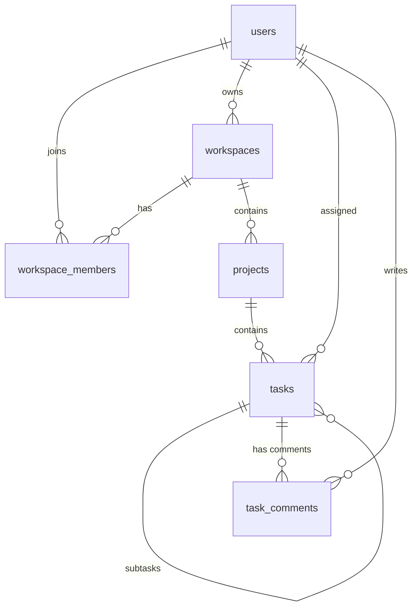

# 🎓 TaskFlow Core API: Enterprise Architecture & In-Depth Study Guide

 **A production-ready NestJS + PostgreSQL codebase crafted as a masterclass curriculum.**
👉 **For the comprehensive line-by-line, flow-by-flow textbook guide, read: [LEARNING_GUIDE.md](file:///c:/Projects/Self/Learning/nest-projects/taskflow-api/LEARNING_GUIDE.md)**

---

## 📑 Table of Contents
1. [Core Domain & High-Level Idea](#1-core-domain--high-level-idea)
2. [Master Curriculum: What You Will Learn](#2-master-curriculum-what-you-will-learn)
3. [Request Lifecycle Flow (How NestJS Works Under the Hood)](#3-request-lifecycle-flow)
4. [Step-by-Step Exploration Roadmap (6-Stage Guided Study)](#4-step-by-step-exploration-roadmap)
5. [Database Schema & Relational Breakdown](#5-database-schema--relational-breakdown)
6. [Interactive Hands-on Exercises & Challenges](#6-interactive-hands-on-exercises--challenges)
7. [Running the Application](#7-running-the-application)

---

## 1. Core Domain & High-Level Idea

### What is TaskFlow Core?
TaskFlow Core is an **Enterprise SaaS Project & Task Management API** modeled after world-class platforms like **Linear**, **Jira**, and **Asana**.

### Why is this domain ideal for mastering NestJS?
Instead of a toy CRUD application, TaskFlow tackles real-world engineering constraints:
- **Multi-Tenancy**: Users can own or join multiple workspaces with distinct roles (`OWNER`, `ADMIN`, `MEMBER`, `VIEWER`).
- **Atomic Transactions**: Creating a workspace requires writing the workspace record *and* assigning the creator as `OWNER` inside a single, rollback-safe database transaction.
- **Hierarchical Relational Data**: Tasks support self-referential subtasks (parent-to-child), assignees, priorities, estimated/actual hours, and discussion comment threads.
- **Default-Deny Security**: Every single endpoint requires a validated JWT access token unless explicitly marked with `@Public()`.
- **Standardized Envelopes**: Every API response (success or failure) adheres to a predictable JSON contract.

---

## 2. Master Curriculum: What You Will Learn

By dissecting this codebase, you will master the following core and advanced backend disciplines:

```
┌─────────────────────────────────────────────────────────────────────────────┐
│                       TASKFLOW LEARNING SPECTRUM                            │
├────────────────────────┬──────────────────────────┬─────────────────────────┤
│ 1. NESTJS INTERNALS    │ 2. SECURITY & AUTH       │ 3. DATABASE & POSTGRES  │
│ • IoC & DI Container   │ • JWT Strategy & Guards  │ • TypeORM Relational    │
│ • Modules & Exports    │ • Refresh Token Rotation │ • Self-referencing FKs  │
│ • Custom Param Decos   │ • Bcrypt Password Hash   │ • QueryRunner Transacts │
│ • Global Interceptors  │ • Role-Based RBAC        │ • Soft-Deletes & UUIDs  │
├────────────────────────┼──────────────────────────┼─────────────────────────┤
│ 4. INPUT & RES INTEGRITY│ 5. ARCHITECTURE         │ 6. TEST & DEVXP         │
│ • Class-Validator DTOs │ • Clean Architecture/DDD │ • Mock-based Unit Tests │
│ • Standard Res Envelope│ • Separation of Concerns │ • Supertest E2E Tests   │
│ • RFC Error Envelopes  │ • Generic Pagination     │ • Auto-Seeder Script    │
│ • Strict Whitelisting  │ • Decoupled Config Layer │ • Swagger 3.0 OpenAPI   │
└────────────────────────┴──────────────────────────┴─────────────────────────┘
```

---

## 3. Request Lifecycle Flow

When an HTTP client (frontend, mobile app, or Swagger) calls an endpoint, NestJS executes a strict, multi-stage pipeline:

```
                  ┌───────────────────────────────┐
                  │      Incoming HTTP Request    │
                  └───────────────┬───────────────┘
                                  │
                                  ▼
      Stage 1: [ LoggingInterceptor ]  (Records timestamp & URL)
                                  │
                                  ▼
      Stage 2: [ HttpExceptionFilter ] (Armored error catcher)
                                  │
                                  ▼
      Stage 3: [ JwtAuthGuard ]        (Validates Bearer token or checks @Public())
                                  │
                                  ▼
      Stage 4: [ RolesGuard ]          (Checks user role against @Roles())
                                  │
                                  ▼
      Stage 5: [ ValidationPipe ]      (Validates & casts body against DTO class)
                                  │
                                  ▼
      Stage 6: [ Controller ]          (Routes request, unbinds @CurrentUser())
                                  │
                                  ▼
      Stage 7: [ Service Layer ]       (Enforces business logic & transactions)
                                  │
                                  ▼
      Stage 8: [ TypeORM / Postgres ]  (Executes SQL queries with parameters)
                                  │
                                  ▼
      Stage 9: [ TransformInterceptor] (Wraps payload in standard response envelope)
                                  │
                                  ▼
                  ┌───────────────────────────────┐
                  │    HTTP 200 / 201 Response    │
                  └───────────────────────────────┘
```

---

## 4. Step-by-Step Exploration Roadmap

Follow these 6 stages in order to build a deep, photographic understanding of the codebase.

---

### 🟢 Stage 1: The Foundation & Cross-Cutting Core
*Start here to see how NestJS bootstraps and configures global behaviors.*

1. **Bootstrap Entrypoint**: Inspect [`src/main.ts`](file:///c:/Projects/Self/Learning/nest-projects/taskflow-api/src/main.ts).
   - *Look for*: How `app.setGlobalPrefix('api/v1')`, `ValidationPipe`, and Swagger `DocumentBuilder` are attached.
2. **Root Module**: Open [`src/app.module.ts`](file:///c:/Projects/Self/Learning/nest-projects/taskflow-api/src/app.module.ts).
   - *Look for*: How `APP_GUARD`, `APP_INTERCEPTOR`, and `APP_FILTER` tokens provide application-wide cross-cutting concerns without polluting controllers.
3. **Response Envelope**: Open [`src/common/interceptors/transform.interceptor.ts`](file:///c:/Projects/Self/Learning/nest-projects/taskflow-api/src/common/interceptors/transform.interceptor.ts).
   - *Learn*: How RxJS `map` operators intercept return values to wrap them in `{ success: true, statusCode, data, timestamp }`.
4. **Standard Error Filter**: Open [`src/common/filters/http-exception.filter.ts`](file:///c:/Projects/Self/Learning/nest-projects/taskflow-api/src/common/filters/http-exception.filter.ts).
   - *Learn*: How Nest catches both handled `HttpException` and unhandled runtime crashes, returning clean, unified JSON.
5. **Configuration Layer**: Review [`src/config/`](file:///c:/Projects/Self/Learning/nest-projects/taskflow-api/src/config/).
   - *Learn*: How `registerAs()` enables type-safe environment variable injection.

---

### 🔵 Stage 2: Identity, Authentication & Security
*Understand how stateless authentication and role-based authorization work.*

1. **User Entity**: Open [`src/modules/users/entities/user.entity.ts`](file:///c:/Projects/Self/Learning/nest-projects/taskflow-api/src/modules/users/entities/user.entity.ts).
   - *Note*: `@Column({ select: false }) password: string` ensures password hashes are never accidentally sent in SQL queries unless explicitly requested.
2. **Passport JWT Strategy**: Open [`src/modules/auth/strategies/jwt.strategy.ts`](file:///c:/Projects/Self/Learning/nest-projects/taskflow-api/src/modules/auth/strategies/jwt.strategy.ts).
   - *Learn*: How Passport extracts the bearer token, verifies signature and expiration, and binds the payload to `request.user`.
3. **Default-Deny Guard**: Open [`src/common/guards/jwt-auth.guard.ts`](file:///c:/Projects/Self/Learning/nest-projects/taskflow-api/src/common/guards/jwt-auth.guard.ts).
   - *Learn*: How `reflector.getAllAndOverride(IS_PUBLIC_KEY)` allows `@Public()` routes (like `/auth/login`) to bypass authentication while keeping all other routes locked by default.
4. **Custom Parameter Decorator**: Open [`src/common/decorators/current-user.decorator.ts`](file:///c:/Projects/Self/Learning/nest-projects/taskflow-api/src/common/decorators/current-user.decorator.ts).
   - *Learn*: How `@CurrentUser('id') userId: string` extracts authenticated session properties cleanly without touching the raw Express `req` object.

---

### 🟡 Stage 3: Multi-Tenancy & Database Transactions
*See how real-world SaaS organizations handle workspaces and database safety.*

1. **Entities**: Examine [`src/modules/workspaces/entities/workspace.entity.ts`](file:///c:/Projects/Self/Learning/nest-projects/taskflow-api/src/modules/workspaces/entities/workspace.entity.ts) and [`workspace-member.entity.ts`](file:///c:/Projects/Self/Learning/nest-projects/taskflow-api/src/modules/workspaces/entities/workspace-member.entity.ts).
   - *Learn*: How `@Unique(['workspaceId', 'userId'])` prevents duplicate memberships.
2. **Atomic Transactions**: Open [`src/modules/workspaces/workspaces.service.ts`](file:///c:/Projects/Self/Learning/nest-projects/taskflow-api/src/modules/workspaces/workspaces.service.ts) and read the `create()` method.
   - *Learn*: How `dataSource.createQueryRunner()` initiates `startTransaction()`, creates the workspace, auto-creates the `OWNER` membership record, and commits or rolls back atomically.
3. **Role Checks**: Study `verifyWorkspaceRole()` in `WorkspacesService`.
   - *Learn*: How fine-grained workspace permissions (`OWNER`, `ADMIN`, `MEMBER`, `VIEWER`) protect tenant resources.

---

### 🟣 Stage 4: Relational Projects & Filtering
*Explore project grouping and dynamic SQL queries.*

1. **Project Entity**: Open [`src/modules/projects/entities/project.entity.ts`](file:///c:/Projects/Self/Learning/nest-projects/taskflow-api/src/modules/projects/entities/project.entity.ts).
   - *Note*: `@Unique(['workspaceId', 'key'])` ensures that project keys (e.g. `CORE`, `MOBILE`) are unique *per workspace*, but different workspaces can have identical keys!
2. **QueryBuilder & Pagination**: Open [`src/modules/projects/projects.service.ts`](file:///c:/Projects/Self/Learning/nest-projects/taskflow-api/src/modules/projects/projects.service.ts) and read `findAll()`.
   - *Learn*: How `createQueryBuilder` dynamically chains conditions (`innerJoin`, `andWhere`, `skip`, `take`, `getManyAndCount()`) while preventing SQL injection.

---

### 🟠 Stage 5: Rich Tasks, Subtasks & Comment Discussions
*Master complex relational interactions and self-referencing trees.*

1. **Self-Referential Entity**: Open [`src/modules/tasks/entities/task.entity.ts`](file:///c:/Projects/Self/Learning/nest-projects/taskflow-api/src/modules/tasks/entities/task.entity.ts).
   - *Master this*:
     ```ts
     @ManyToOne(() => TaskEntity, (task) => task.subtasks, { onDelete: 'CASCADE' })
     parentTask: TaskEntity;

     @OneToMany(() => TaskEntity, (task) => task.parentTask)
     subtasks: TaskEntity[];
     ```
     This allows tasks to nest subtasks indefinitely!
2. **Discussions**: Open [`src/modules/tasks/entities/comment.entity.ts`](file:///c:/Projects/Self/Learning/nest-projects/taskflow-api/src/modules/tasks/entities/comment.entity.ts).
   - *Learn*: How each comment connects both to a `task` and an `author` (User), letting team members collaborate on tasks.

---

### 🔴 Stage 6: Database Seeding & Unit Testing
*Study how enterprise applications are populated and verified.*

1. **Auto-Database Seeder**: Open [`src/database/seeds/initial-seed.ts`](file:///c:/Projects/Self/Learning/nest-projects/taskflow-api/src/database/seeds/initial-seed.ts).
   - *Learn*: How `ensureDatabaseExists()` automatically queries PostgreSQL system catalogs (`pg_database`) and creates `taskflow_db` if not found.
2. **Service Unit Testing**: Open [`src/modules/auth/auth.service.spec.ts`](file:///c:/Projects/Self/Learning/nest-projects/taskflow-api/src/modules/auth/auth.service.spec.ts).
   - *Learn*: How `Test.createTestingModule` mocks `UsersService` and `JwtService` using Jest `jest.fn()` to test login and password logic without touching a real database.

---

## 5. Database Schema & Relational Breakdown



### Table Dictionary:
- `users`: Core authentication identity, global system role (`SYSTEM_ADMIN`, `USER`), hashed credentials.
- `workspaces`: High-level tenant organization (e.g., Company, Department).
- `workspace_members`: Junction table connecting users and workspaces with workspace-level roles (`OWNER`, `ADMIN`, `MEMBER`, `VIEWER`).
- `projects`: Workspace containers for tracking initiatives, with statuses (`PLANNING`, `ACTIVE`, `COMPLETED`, `ARCHIVED`).
- `tasks`: Core work item with priority, estimated hours, actual hours, due dates, assignee, and parent-task relation.
- `task_comments`: Chronological discussion feed attached to each task.

---

## 6. Interactive Hands-on Exercises & Challenges

To cement your learning, try implementing these 4 progressive challenges:

### 🥉 Challenge 1 (Beginner): Add a New Task Priority
- Add an `EPIC` or `CRITICAL` priority to [`src/common/constants/role.enum.ts`](file:///c:/Projects/Self/Learning/nest-projects/taskflow-api/src/common/constants/role.enum.ts).
- Update [`CreateTaskDto`](file:///c:/Projects/Self/Learning/nest-projects/taskflow-api/src/modules/tasks/dto/create-task.dto.ts) and verify that Swagger updates automatically.

### 🥈 Challenge 2 (Intermediate): Add a "My Assigned Tasks" Endpoint
- Create a dedicated endpoint `GET /tasks/assigned-to-me` in [`TasksController`](file:///c:/Projects/Self/Learning/nest-projects/taskflow-api/src/modules/tasks/tasks.controller.ts).
- Use `@CurrentUser('id') userId: string` to filter tasks where `task.assigneeId = :userId`.

### 🥇 Challenge 3 (Advanced): Task Tags & Labels (Many-to-Many)
- Create a new `LabelEntity` (`id`, `name`, `colorHex`, `workspaceId`).
- Add a `@ManyToMany` relationship between `TaskEntity` and `LabelEntity`.
- Add an endpoint to tag tasks with labels.

### 🏆 Challenge 4 (Architect): Task Activity Audit Log
- Create an `AuditLogEntity` that logs whenever a task status changes (e.g. from `TODO` to `IN_PROGRESS`), recording who changed it and the timestamp.

---

## 7. Running the Application

### 1. Seed & Auto-Create Database:
```bash
npm run seed
```

### 2. Start in Watch Mode:
```bash
npm run start:dev
```

### 3. Open Interactive Swagger UI:
Go to **`http://localhost:3000/api/docs`** in your browser.

#### Demo Credentials:
- **System Admin**: `admin@taskflow.dev` / `Admin@123456`
- **Lead Developer**: `alex@taskflow.dev` / `User@123456`
